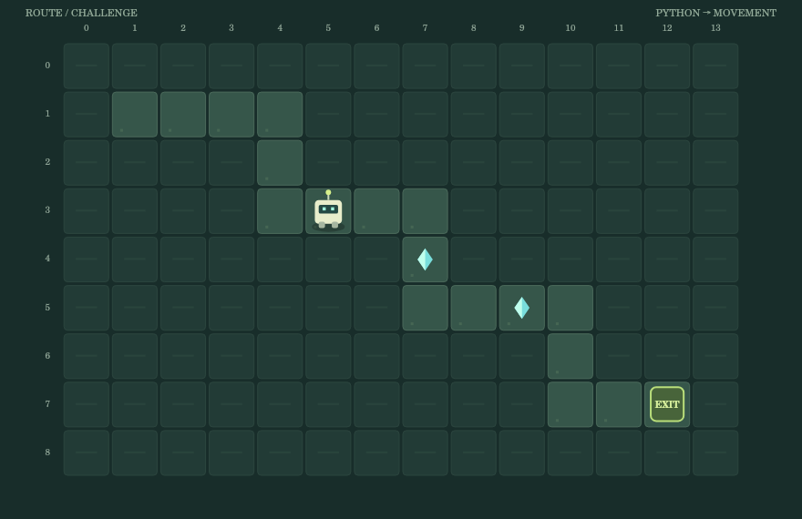

# Crystal Courier

A visual Python game for the bridge between CS50P Weeks 2 and 3. Program a robot to collect crystals and reach the exit.

## Start in cs50.dev

For your first download:

```bash
wget https://raw.githubusercontent.com/MrDiaz-cpu/class_work/main/crystal_courier/crystal_courier.zip
unzip crystal_courier.zip
cd crystal_courier
python play.py
```

Open **Ports → 8080 → Open in Browser**. If necessary, add/forward port `8080` first. Keep the port **Private** and leave the terminal server running.

If you already have a folder with your work, open it and run `python play.py`; do not unzip over your saved Python. If port 8080 is occupied, use `python play.py --port 8081` and open port 8081.

## Tutorial, challenge, remix

1. Code along with your teacher in `tutorial.py` and select **Tutorial**.
2. Complete `mission.py` to collect every crystal and reach the exit in **Challenge**.
3. Run **Remix** with the same saved code and new crystal positions.

Edit Python in cs50.dev, save, then click **Run saved Python** in the game tab. Every run starts fresh. **Replay** replays the previous result. The page highlights the Python line behind each move; use **Pause** and **Next action** to trace it.

[Read the full student instructions](STUDENT_INSTRUCTIONS.md).



## Commands

| Command | Result |
|---|---|
| `move("right")` | Move one square; also accepts `"left"`, `"up"`, `"down"` |
| `on_crystal()` | Return whether a crystal is under the robot |
| `collect()` | Pick up the crystal on the current square |
| `can_move("right")` | Return whether the adjacent square is clear |
| `at_exit()` | Return whether the robot is on the exit |

Student work uses functions, arguments, loops, and conditionals. The import line, Python engine, and browser graphics are supplied. No package installation is needed (Python 3.9+ and a modern browser).

## Check your work

In a second terminal, inside the same project folder:

```bash
python play.py --check challenge
python play.py --check remix
```

Both should report **Delivery complete!** Submit `mission.py` and the exit ticket through the system your teacher specifies. No hosted check50/submit50 slug is configured for this lesson.

## Validation

Python game tests and browserless playback-controller checks passed. Full browser layout and the signed-in cs50.dev workflow still need a check on a school device. The preview is a render from the canvas code, not a full browser screenshot.

Original classroom extension; not an official CS50 problem set.
